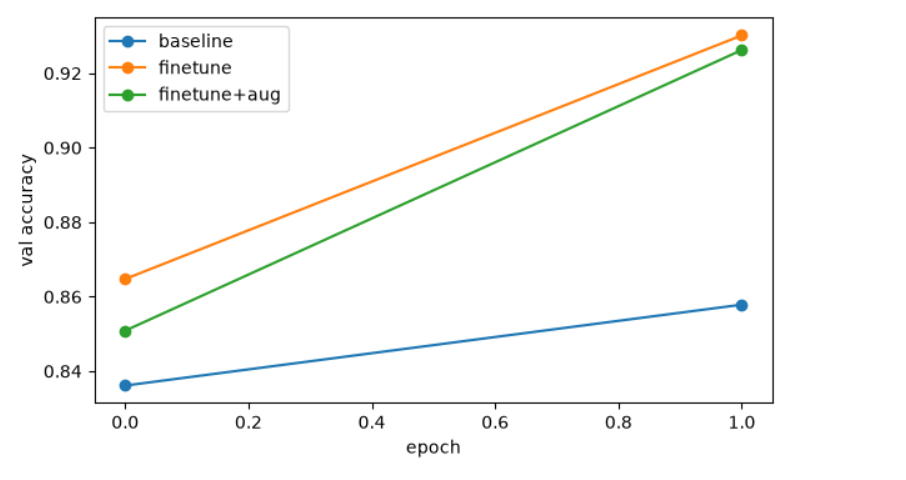
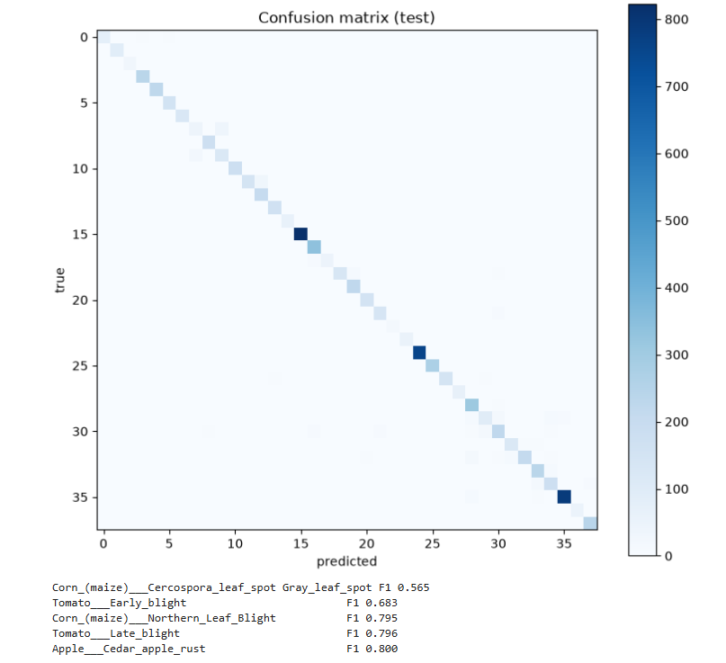
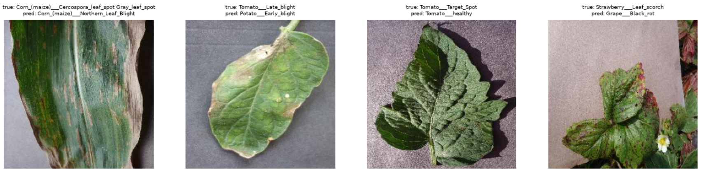
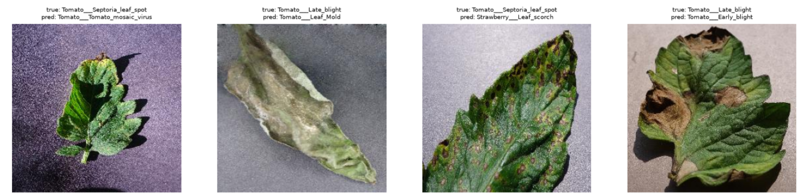
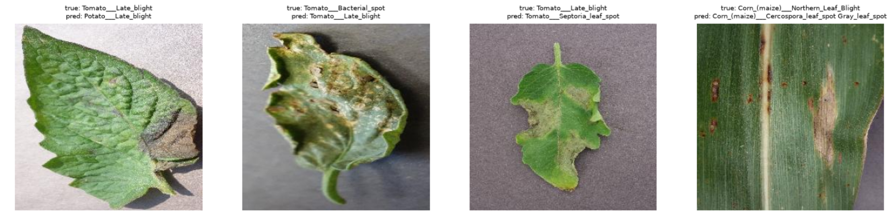

# Plant Leaf Disease Classifier (Transfer Learning)

Fine-tuning a small pretrained CNN (MobileNetV3-Small, ImageNet weights) to classify plant leaf diseases on the PlantVillage dataset. This is Project 40 from the "45 Small Self-learning Projects" list.

**Question:** Does fine-tuning a pretrained CNN beat a frozen-feature baseline on plant leaf disease, and where does it still fail?

## Dataset

- PlantVillage, colour images: 54,305 images, 38 classes (14 crops, healthy and diseased)
- Source: Kaggle `abdallahalidev/plantvillage-dataset`, downloaded with `kagglehub`
- Stratified split (seed 42): 70% train, 15% validation, 15% test
- Because of CPU limits, **training used only 25% of the training split (about 9,500 images)**. Validation (8,146) and test (8,146) images were kept in full.

## Method

| Run | Description |
| --- | --- |
| Frozen baseline | Pretrained backbone frozen; only the new 38-class output layer is trained (lr 1e-3) |
| Fine-tuned | Whole network trained (lr 1e-4) |
| Fine-tuned + augmentation | As above, with random flip, rotation (20°) and colour jitter |

Settings shared by all runs: MobileNetV3-Small, images resized to 128×128, batch size 32, AdamW, cross-entropy loss, 2 epochs, seed 42, CPU only. The checkpoint with the best validation accuracy is used for testing.

## Results

Test-set results (8,146 images; best-validation checkpoint of each run). Validation accuracy after epoch 2 is shown for reference; the baseline and fine-tuned values are read from the learning curves, so they are approximate.

| Run | Val acc (epoch 2) | Test acc | Macro-F1 |
| --- | --- | --- | --- |
| Frozen baseline | about 0.86 | 0.8575 | 0.8177 |
| Fine-tuned | about 0.93 | **0.9332** | **0.9085** |
| Fine-tuned + augmentation | 0.926 | 0.9293 | 0.9016 |



Fine-tuning improved test accuracy by about 7.6 percentage points (0.8575 to 0.9332) and macro-F1 by about 9 points (0.8177 to 0.9085) over the frozen baseline. The larger macro-F1 gain shows that fine-tuning helped the harder, smaller classes the most.

Augmentation gave no benefit here: it scored 0.4 points lower in test accuracy (0.9293 vs 0.9332) and 0.7 points lower in macro-F1. This is a small difference from a single seed and only 2 epochs, so it should not be read as augmentation being harmful. A likely explanation is that 2 epochs is too short for the harder training task to pay off; its training accuracy in epoch 1 was only 0.576, so it was still catching up.

An earlier frozen-baseline run on full-size (224px) images and the full training split reached 95.47% test accuracy and macro-F1 0.942. That run used different settings, so it is not directly comparable with the table above. It does show that the reduced setup (128px, 25% of the data) costs a lot for a frozen backbone (about 10 points), so the absolute numbers here are lower than what this method can achieve.

## Per-class results

The five weakest classes in the fine-tuned model (by F1), with the overall test macro-F1 of 0.9085 for comparison:

| Class | F1 |
| --- | --- |
| Corn (maize), Cercospora leaf spot / Gray leaf spot | 0.565 |
| Tomato, Early blight | 0.683 |
| Corn (maize), Northern Leaf Blight | 0.795 |
| Tomato, Late blight | 0.796 |
| Apple, Cedar apple rust | 0.800 |



The confusion matrix is strongly diagonal. The dark cells are the largest classes, which shows class imbalance in the dataset.

## Error analysis

Twelve misclassified test images (true label → predicted label):





| # | True | Predicted | Likely reason |
| --- | --- | --- | --- |
| 1 | Tomato Late blight | Potato Late blight | Same disease on a related crop; leaf shape is similar |
| 2 | Tomato Bacterial spot | Tomato Late blight | Both produce brown, necrotic patches; this leaf is badly curled |
| 3 | Tomato Late blight | Tomato Septoria leaf spot | Pale grey lesion resembles another spot disease |
| 4 | Corn Northern Leaf Blight | Corn Cercospora/Gray leaf spot | Both cause elongated tan lesions on corn |
| 5 | Tomato Septoria leaf spot | Tomato mosaic virus | Small leaf, fine speckling, purple background |
| 6 | Tomato Late blight | Tomato Leaf mold | Greyish, mouldy-looking surface |
| 7 | Tomato Septoria leaf spot | Strawberry Leaf scorch | Dark spots on a close-up leaf; crop confusion |
| 8 | Tomato Late blight | Tomato Early blight | Large brown lesions look alike |
| 9 | Corn Cercospora/Gray leaf spot | Corn Northern Leaf Blight | The reverse of #4 |
| 10 | Tomato Late blight | Potato Early blight | Wrong crop and wrong disease; subtle lesion |
| 11 | Tomato Target spot | Tomato healthy | Disease signs are faint |
| 12 | Strawberry Leaf scorch | Grape Black rot | Close-up with a cluttered background and flower |

Patterns: most errors are between visually similar diseases on the same crop (blights and leaf spots), especially tomato and corn. A few are cross-crop mistakes. These are my own readings of the images, not verified by a plant pathologist.

## Limitations

- **Possible data leakage.** PlantVillage has several photos of each physical leaf, and the random split can put near-duplicates in both train and test. This inflates accuracy. Splitting by leaf (the Hugging Face copy `mohanty/PlantVillage` has a `leaf_id` field) would give a more honest estimate. This was not done.
- **Reduced training setup.** 25% of the training data, 128px images and 2 epochs, because of CPU limits. Absolute accuracy would likely be higher with full settings.
- **Single seed.** Small differences between runs (such as with and without augmentation) are within what random variation could produce.
- **Controlled images.** PlantVillage photos are taken in controlled conditions. These results do not show that the model would work on field photos.

## How to run

```bash
pip install torch torchvision scikit-learn matplotlib kagglehub
jupyter notebook project40_plant_leaf_transfer_learning.ipynb
```

Run the cells in order. The dataset downloads automatically through `kagglehub` (about 2 GB). Trained weights (`*.pt`) and results are written to the notebook's folder.

## Repository layout

```
.
├── project40_plant_leaf_transfer_learning.ipynb
├── figures/
├── results.json
├── README.md
└── .gitignore
```

## References

- Hughes, D. P. and Salathé, M. (2015). An open access repository of images on plant health to enable the development of mobile disease diagnostics. arXiv:1511.08060.
- Mohanty, S. P., Hughes, D. P. and Salathé, M. (2016). Using deep learning for image-based plant disease detection. Frontiers in Plant Science, 7:1419.
